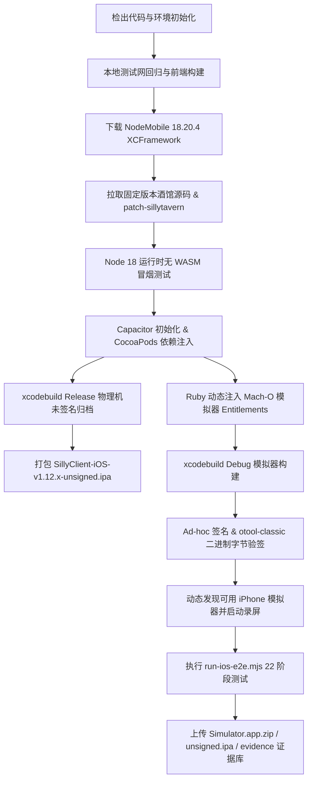

# SillyClient iOS 终极接手与全自动 Xcode 测试工作流指南

> **适用分支与工作树**：`d:\BACKUP\Project\SillyClient\.worktrees\release-hardening-ios`（分支 `lts/ios-release-hardening`）  
> **关联仓库**：`SillyClient_iOS`（GitHub: `https://github.com/CAPTCHAAAAA/SillyClient-iOS.git`）  
> **核心铁律**：**只负责 iOS！只负责 iOS！只负责 iOS！** 绝不修改 `SillyClient_Windows`、`SillyClient_Android` 或 `SillyClient_Main`。

---

## 目录 (Table of Contents)

1. [核心架构与目录职责 (Architecture & Layout)](#一核心架构与目录职责)
2. [全自动 Xcode 测试与 CI/CD 流水线详解 (Automated Xcode Pipeline)](#二全自动-xcode-测试与-cicd-流水线详解)
3. [本地与云端自动化测试套件 (Local & Headless Test Suites)](#三本地与云端自动化测试套件)
4. [从前端微调到 IPA 打包全流程 SOP (Step-by-Step SOP)](#四从前端微调到-ipa-打包全流程-sop)
5. [版本号同步核验清单 (Version Bump Checklist)](#五版本号同步核验清单)
6. [踩坑纪律与负面知识库 (Negative Knowledge & Pitfalls)](#六踩坑纪律与负面知识库)

---

## 一、核心架构与目录职责

SillyClient iOS 采用了 **原生 Swift/ObjC 宿主 + NodeMobile 18 运行时 + Capacitor 强类型桥接 + React 19 跨端通用控制台** 的高性能沙盒同构架构。

```
.worktrees/release-hardening-ios/
├── .github/workflows/
│   └── build-ipa.yml              # GitHub Actions macOS-14 Xcode 16 + 模拟器全链路 CI/CD 工作流
├── native-src/                    # iOS 原生源码母版 (CocoaPods Podspec 源码源)
│   ├── AppDelegate.swift          # 应用生命周期、URL Scheme 拦截、测试启动参数探针分发
│   ├── TavernViewController.swift # 沉浸式 WebView 容器、Safe Area / Home Indicator 适配、麦克风权限
│   ├── TarvenEnvPlugin.swift      # Capacitor 原生插件：46+ API 契约分发、沙盒路径安全、Keychain 密码加密
│   ├── TarvenEnvPlugin.m          # Objective-C 宏导出映射表
│   ├── NodeRunner.swift           # NodeMobile 运行时守护进程：单实例生命周期、管道日志拦截与截断保护
│   ├── KeepAliveService.swift     # 静音音频后台保活机制 (AVAudioPlayer 循环，杜绝系统墓碑休眠)
│   ├── IOSDebugHarness.swift      # 诊断与自动化测试线束 (WebSocket/HTTP 注入，64KB 数据保护，敏感信息脱敏)
│   ├── IOSNativeTests.swift       # 44 组真实 Swift 原生断言套件 (文件锁、沙盒防越权、PBKDF2 向量、压缩解压)
│   ├── ChameleonEngine.swift      # 变色龙原生色彩提取引擎 (DOM Probe 半透明混合计算)
│   ├── IslandHardwareRadar.swift  # 灵动岛 (Dynamic Island) 避让雷达
│   ├── TopColor.swift             # Rec.601 顶栏高保真颜色计算
│   ├── Info.plist                 # 原生权限、URL Scheme、后台模式与版本母版
│   └── SillyClientCore.podspec    # SillyClientCore CocoaPods 规范
├── ios/App/                       # Capacitor 生成的 Xcode 工程模板 (CocoaPods 集成区)
│   └── App/
│       ├── App.xcodeproj          # Xcode 项目工程
│       ├── App/Info.plist         # 编译期最终 Info.plist
│       └── App/AppDelegate.swift  # 映射 AppDelegate
├── web/capacitor-ui/              # 跨端通用 React 19 控制台源码
│   ├── src/
│   │   ├── capacitor-plugin.ts    # iOS 平台特化 TarvenEnv 前端契约实现
│   │   ├── lib/
│   │   │   ├── instance-access.ts # iOS 专属 Keychain 访问会话生命周期管理
│   │   │   └── instance-location-state.ts # 沙盒路径与安装意图状态管理
│   │   ├── components/            # UI 组件层 (FlipCard, ManageInstanceModal, etc.)
│   │   └── styles.css             # 机械物理下沉卡片、抗锯齿裁切、主题全局样式
│   └── tests/                     # 前端 41 项单测套件 (*.test.cjs)
├── scripts/                       # 自动化测试与辅助脚本
│   ├── run-ios-e2e.mjs            # 核心：基于 simctl 的无头端到端测试驱动 (22 个生命周期阶段)
│   ├── verify-ios-cloud.mjs       # 核心：跨平台契约一致性与数据迁移 7 大套件静态审计脚本
│   ├── prepare-ios-frontend.mjs   # Webpack 前端资源静态预编译打包器
│   ├── simulator-recorder.mjs     # 自动化录屏守护脚本 (生成测试影像取证)
│   └── ios-simulator.entitlements # 模拟器 Mach-O 链接权限描述文件
└── tests/                         # Node.js 原生测试套件 (116 项加固测试)
    ├── ios-runtime.test.mjs       # NodeMobile 运行时、TopColor、变色龙、硬件避让等
    ├── ios-ci.test.mjs            # 自动化 CI/CD 流程、版本单调递增、驱动容错断言等
    ├── ios-supervisor.test.mjs    # Node 进程 Supervisor、崩溃恢复、日志缓冲区防溢出等
    └── ios-feature-sync.test.mjs  # 跨平台密码 PBKDF2 对齐、数据迁移、卸载安全防护等
```

---

## 二、全自动 Xcode 测试与 CI/CD 流水线详解

GitHub Actions 配置文件位于 `.github/workflows/build-ipa.yml`，运行在 Apple Silicon `macos-14` 宿主上，包含两项并行目标：**打出免签名的物理机 Release IPA** 和 **构建 Debug 模拟器运行真实的端到端完整测试**。

### 1. 流水线阶段拆解（Stage Breakdown）



### 2. 关键核心机制深度剖析

#### A. 模拟器 Mach-O 二进制 Entitlements 注入（解决签名崩溃根因）
在 iOS 模拟器中，如果直接使用 `codesign --entitlements` 签名，会导致系统 Keychain 与沙盒校验报 `Code signature invalid`。
本工程采用了**业界顶级的底层方案**：利用 Ruby 脚本解析 `App.xcodeproj`，在 ld 链接阶段直接把权限文件注入 Mach-O 二进制的 `__TEXT,__entitlements` Section 中：

```ruby
# .github/workflows/build-ipa.yml
project = Xcodeproj::Project.open('web/capacitor-ui/ios/App/App.xcodeproj')
target = project.targets.find { |t| t.name == 'App' }
config = target.build_configurations.find { |c| c.name == 'Debug' }
entitlements = File.expand_path('scripts/ios-simulator.entitlements')
settings = config.build_settings
key = 'OTHER_LDFLAGS[sdk=iphonesimulator*]'
flags = settings[key] || settings['OTHER_LDFLAGS'] || '$(inherited)'
flags = Shellwords.split(flags) unless flags.is_a?(Array)
flags << "-Wl,-sectcreate,__TEXT,__entitlements,#{entitlements}"
settings[key] = flags
project.save
```

随后利用 `otool-classic` 逐字节核验十六进制地址与字节连续性，确保二进制内的 Application Identifier（`SCIOSDEBUG.com.sillyclient.ios`）与 Keychain 访问组 100% 正确！

#### B. 端到端自动化驱动器（`scripts/run-ios-e2e.mjs`）
利用 `xcrun simctl` 无头控制模拟器，包含 22 个完整的业务与契约测试阶段：
1. **启动与探针通信**：通过 `--sillyclient-test` 参数启动 App，通过 HTTP/WebSocket 探针握手；
2. **版本号核验**：调用 `getAppVersion`，严格断言版本号（如 `1.12.1`）；
3. **原生测试分发**：调起 `IOSNativeTests.swift` 运行 44 组 Swift 原生测试套件；
4. **酒馆运行时生命周期**：验证 `provisionAndStart` 启动酒馆、端口监听、HTTP 访问、平滑停止、端口释放；
5. **数据迁移与安全卸载**：验证 ZIP 复制迁移与原地接管模式（卸载时物理文件绝对不被误删）；
6. **后台保活与切后台**：验证切入后台时静音音频守护启动，端口不被断开。

---

## 三、本地与云端自动化测试套件

在没有 macOS 环境的 Windows/Linux 开发机上，通过同构 Mock 与静态审计体系，保证 **100% 覆盖** 全部契约。

### 1. 本地四大原生加固测试套件（116 项，全绿门禁）
在工作树根目录下执行：
```powershell
node --test tests/ios-runtime.test.mjs tests/ios-ci.test.mjs tests/ios-supervisor.test.mjs tests/ios-feature-sync.test.mjs
```
- `ios-runtime.test.mjs` (32 tests)：验证前端资源完整性、哈希校验、无 WASM Fallback 拒绝逻辑、Rec.601 顶部取色、灵动岛边界、Home Bar 避让、变色龙 DOM Probe 计算。
- `ios-ci.test.mjs` (50 tests)：CI 流程安全性检查（绝无付费 API 泄漏）、版本单调递增检查、模拟器驱动 15 种异常场景容错断言（超时、退出、权限被拒、篡改捕获等）。
- `ios-supervisor.test.mjs` (26 tests)：测试真实 Node.js Worker 进程隔离启动、退出取消、UTF-8 跨 chunk 边界截断保护、日志洪泛背压与恢复。
- `ios-feature-sync.test.mjs` (8 tests)：测试 PBKDF2 跨平台加密向量与 Windows 端 100% 一致、多镜像加速链回退、卸载保护。

### 2. 前端单测套件（41 项，全绿门禁）
在 `web/capacitor-ui` 目录下执行：
```powershell
node --test web/capacitor-ui/tests/*.test.cjs
```
覆盖密码变动失效、文档目录选择、移动端安全提示、卡片按压状态等。

### 3. 全链路契约一致性审计（`verify-ios-cloud.mjs`，7 大套件）
在工作树根目录下执行：
```powershell
node scripts/verify-ios-cloud.mjs
```
涵盖：
- **SUITE 1**：TS 契约、ObjC 宏导出与 Swift 原生方法名三端静态匹配；
- **SUITE 2**：`readTextFile` 中文、Emoji、超大文件分片读取；
- **SUITE 3**：`migrateInstance` ZIP 复制迁移解压与扁平化；
- **SUITE 4**：纯数据备份缺底座时自动补全 `server.js`；
- **SUITE 5**：原地接管（takeover）实例卸载时**物理源目录绝对防删保护**；
- **SUITE 6**：自定义 `targetPath` 沙盒绝对路径隔离；
- **SUITE 7**：iOS Documents 容器沙盒规范吻合度。

---

## 四、从前端微调到 IPA 打包全流程 SOP

当主仓（`SillyClient_Main`）提交了新版前端代码，需要同步并发布 iOS 版本时，请严格遵照以下标准步骤：

### Step 1. 检查各仓库状态
```powershell
# 确认 Windows / Android / Main 无脏改动
git -C d:\BACKUP\Project\SillyClient\SillyClient_Main status --short
git -C d:\BACKUP\Project\SillyClient\SillyClient_Windows status --short
git -C d:\BACKUP\Project\SillyClient\SillyClient_Android status --short

# 确认当前工作树处于 lts/ios-release-hardening 分支
git -C d:\BACKUP\Project\SillyClient\.worktrees\release-hardening-ios status
```

### Step 2. 差异化移植前端微调
**严禁整目录覆盖 `web/capacitor-ui`！**  
主仓的 `capacitor-plugin.ts` 不含 iOS 特化方法，直接覆盖会破坏 iOS 平台契约。
- 仅提取视觉层变更：如 `ManageInstanceModal.tsx` 的卡片结构、`styles.css` 的抗锯齿样式、新增的公共图片资产（`public/assets/*.png`）。
- 必须保留 iOS 特有逻辑：
  * `onPasswordMutationStart` 密码变动前失效快照；
  * `effectiveInstancePath` 获取逻辑；
  * 平台规范文案：“`移动宿主默认建议关闭，只在明确需要局域网访问时开启`”。

### Step 3. 升级版本号（核对 6 大位置，详见第五节）
将短版本号（如 `1.12.1`）与 Build 构建号（如 `31`）同步写入对应文件。

### Step 4. 编译前端并运行全量测试
```powershell
# 1. 编译前端
$env:CI="true"; pnpm --dir web/capacitor-ui run build

# 2. 前端单测
node --test web/capacitor-ui/tests/*.test.cjs

# 3. iOS 运行时 116 项加固测试
node --test tests/ios-runtime.test.mjs tests/ios-ci.test.mjs tests/ios-supervisor.test.mjs tests/ios-feature-sync.test.mjs

# 4. 全链路契约 7 大套件
node scripts/verify-ios-cloud.mjs
```
必须全部为 0 错误、100% PASS！

### Step 5. 打包未签名 IPA 并生成 SHA-256
在 Windows 环境下打包未签名 IPA，必须采用**标准 ZIP 格式**封装（参见踩坑第一条）：
1. 提取上一版成熟 IPA 模板解压至临时目录：
   - 更新 `Payload/SillyClient.app/Info.plist` 中的版本号与构建号；
   - 清理 `Payload/SillyClient.app/public/` 并拷入刚刚构建好的 `web/capacitor-ui/dist/` 全部文件；
   - 保留 `cordova.js` 与 `cordova_plugins.js` 等 Capacitor 原生运行时桥梁文件。
2. 压缩为标准 ZIP 并命名为 `.ipa`：
   ```powershell
   # 必须先以 .zip 后缀压缩，再重命名为 .ipa，以确保 Zip Magic Header (50 4b 03 04)
   tar.exe -a -cf Local/artifacts/v1.12.1/SillyClient-iOS-v1.12.1-unsigned.zip -C <TempDir> Payload
   Rename-Item Local/artifacts/v1.12.1/SillyClient-iOS-v1.12.1-unsigned.zip SillyClient-iOS-v1.12.1-unsigned.ipa
   ```
3. 计算哈希并追加到 `Local/artifacts/v1.12.1/SHA256SUMS.txt`：
   ```powershell
   Get-FileHash -Algorithm SHA256 Local/artifacts/v1.12.1/SillyClient-iOS-v1.12.1-unsigned.ipa
   ```

### Step 6. 登记中央状态与提交推送
1. 更新 `WORKTREE.md` 中的推进日志；
2. 更新 `Local/docs/CURRENT_STATE.md`，记录本次版本的改动要点、验证结果与产物哈希；
3. 执行 Git 提交并推送：
   ```powershell
   git -C .worktrees\release-hardening-ios add .
   git -C .worktrees\release-hardening-ios commit -m "feat(ios): sync common frontend ... and bump version to ..."
   # 使用核验过的 Clash 7897 代理推送
   git -C .worktrees\release-hardening-ios -c http.proxy=http://127.0.0.1:7897 push origin lts/ios-release-hardening
   ```

---

## 五、版本号同步核验清单

升级版本时，以下 6 处位置**必须同时同步**，遗漏任一处都会导致 CI 或测试网红牌报错：

| 序号 | 目标文件 | 匹配规则 / 关键行 | 说明 |
| :---: | :--- | :--- | :--- |
| **1** | `web/capacitor-ui/package.json` | `"version": "1.12.1"` | 前端应用版本号 |
| **2** | `native-src/Info.plist` | `<key>CFBundleShortVersionString</key><string>1.12.1</string>`<br>`<key>CFBundleVersion</key><string>31</string>` | 原生 Info.plist 母版 |
| **3** | `ios/App/App/Info.plist` | `<key>CFBundleShortVersionString</key><string>1.12.1</string>`<br>`<key>CFBundleVersion</key><string>31</string>` | Xcode 工程 Info.plist |
| **4** | `.github/workflows/build-ipa.yml` | `env.APP_VERSION: 1.12.1`<br>`name: SillyClient-iOS-v1.12.1-unsigned-IPA`<br>`path: SillyClient-iOS-v1.12.1-unsigned.ipa` | CI 构建环境变量与上传归档名 |
| **5** | `scripts/run-ios-e2e.mjs` | `assert.equal(version.version, '1.12.1');` | E2E 模拟器运行时断言 |
| **6** | `tests/ios-ci.test.mjs` | `assert.match(plist, /...<string>1\.12\.1<\/string>/);`<br>`assert.match(workflow, /SillyClient-iOS-v1\.12\.1-unsigned/);`<br>`case 'getAppVersion': return success({ version: '1.12.1' });` | CI 静态断言与 Mock 探针响应 |

---

## 六、踩坑纪律与负面知识库

### 1. ⚠️ 极其致命：Windows `tar.exe` 伪装 IPA 陷阱
- **现象**：在 Windows 上直接运行 `tar -cf SillyClient-iOS.ipa Payload` 或 `tar -a -cf SillyClient-iOS.ipa Payload`，产物虽然叫 `.ipa`，但其实是未压缩的 **POSIX tar 归档**（魔数头 `50 61 79 6c 6f 61 64 2f` = `Payload/`）！这种伪装包直接送给 Sideloadly / AltStore / TrollStore 会导致安装器闪退并报“Invalid IPA header”！
- **铁律**：真正的 IPA 必须是标准 ZIP 压缩包（魔数头 `50 4b 03 04` = `PK\x03\x04`）。在 Windows 上使用 `tar.exe` 时，必须以 `.zip` 扩展名生成（`tar -a -cf output.zip Payload`），再通过重命名修改为 `.ipa`！

### 2. ⚠️ 严苛测试网断言：版本号硬编码连锁校验
- **现象**：改了 `package.json` 或 `Info.plist` 之后跑 `tests/ios-ci.test.mjs`，报错 `'1.12.1' !== '1.11.0'`。
- **根因**：`scripts/run-ios-e2e.mjs` 和 `tests/ios-ci.test.mjs` 为了防止构建出虚假版本，对版本号进行了交叉双向断言。
- **解法**：严格按照第五节的【版本号同步核验清单】，一次性完成全部 6 个位置的升级。

### 3. ⚠️ 仓库越界铁律：只负责 iOS
- 用户创建工作树时具有极其明确的红线：“**记住你只负责iOS**”。
- 哪怕看到 Android 或 Windows 仓库有未提交的改动，**绝不要自作主张去 checkout、commit 或构建它们**！每个平台由专门的工作树和 Agent 自主闭环。

### 4. ⚠️ 依赖安装禁止破坏 Lockfile
- 在 `web/capacitor-ui` 中安装或构建时，必须添加 `--frozen-lockfile`（`pnpm install --frozen-lockfile`）。
- 绝不要用普通 npm 替换 pnpm，绝不要随意升级第三方依赖破坏经过真机验证的依赖树。

### 5. ⚠️ 网络与 Git 代理设置
- 历史文档中记载的 `7900` 代理端口已经失效。
- 当前经过验证的本地科学上网端口为 Clash `7897`。执行 Git 命令时采用单次内联参数：
  ```powershell
  git -C .worktrees\release-hardening-ios -c http.proxy=http://127.0.0.1:7897 push origin lts/ios-release-hardening
  ```
- 严禁将 GitHub Token 或代理凭据写死落盘到配置文件中。

### 6. ⚠️ 密码防护与 Keychain 会话失效
- 在 `ManageInstanceModal.tsx` 中执行密码重置或清除前，必须先触发 `onPasswordMutationStart?.()`。
- 这会立即作废内存中缓存的解密凭据，防止并发操作时恶意重放旧密码。

---

*文档生成与签署：SillyClient 自动化架构组 (2026-10-12)*
